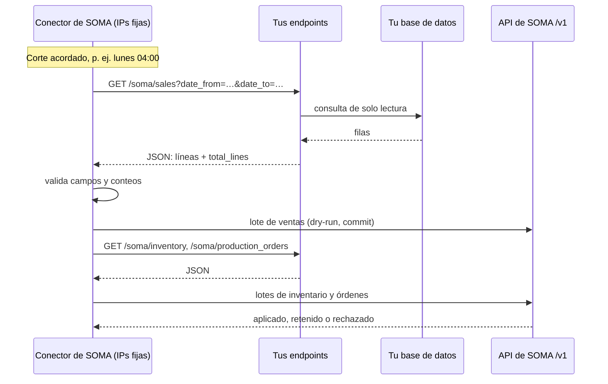

<p class="eyebrow">SOMA Engine · Guía técnica</p>

# Integración por consulta

Tu sistema publica sus datos en unos pocos endpoints de solo lectura, y en cada corte el
conector de SOMA las llama. Tu equipo no programa envíos, lotes ni reintentos: solo responde con
los mismos campos de la API v1.
{ .lead }

<div class="meta" markdown>
<span class="chip">Contrato <b>1.0.0-draft</b></span>
<span class="chip">HTTPS · JSON · UTF-8</span>
<span class="chip">IPs fijas de SOMA + token</span>
</div>

!!! info "En preparación"
    Esta forma de integración se está construyendo. La página describe lo que tu sistema tiene
    que exponer; los detalles del lado de SOMA (tiempos de espera, reintentos) pueden ajustarse
    antes de la primera versión, y cada ajuste queda en el [changelog](../changelog.md).

!!! note "Datos de ejemplo"
    Los ejemplos usan la empresa ficticia *Acme*, con la planta `CD01` y SKUs inventados.

## Envío directo o consulta

Las dos formas usan el mismo contrato de datos. Cambia quién llama a quién.

| | Envío directo ([guía v1](v1.md)) | Por consulta (esta página) |
|---|---|---|
| Quién inicia | Tu sistema llama a la API de SOMA | El conector de SOMA llama a tu sistema |
| Qué construye tu equipo | Lotes, partes, `dry-run`, `commit` y reintentos | De tres a cuatro endpoints de solo lectura |
| Formato de las líneas | El de [Líneas](v1.md#lineas) | El mismo |
| Revisión y calidad de datos | SOMA, igual en las dos | SOMA, igual en las dos |

En los dos casos hay **una sola API: la de SOMA**. En la integración por consulta, los endpoints de
tu sistema son la fuente de datos: el conector de SOMA los lee y entrega los datos a la API de SOMA.

## Cómo funciona



1. A la hora del corte, el conector llama a cada endpoint de tu sistema.
2. Tu servicio lee su base de datos y responde con las líneas y su total.
3. El conector comprueba que recibió todo y que cada línea cumple el contrato. Si algo no calza,
   no envía nada y SOMA conserva los datos anteriores.
4. El conector entrega los datos a SOMA en lotes. Desde ahí rigen la revisión y las protecciones
   de la [guía v1](v1.md#validacion-y-estados).

## Seguridad

- **HTTPS** con TLS 1.2 o superior.
- **IPs fijas.** SOMA te da las direcciones IPv4 fijas desde las que llama su conector, una
  lista por ambiente, y tu servicio solo responde a ellas. No hace falta VPN.
- **Token.** Tu equipo emite un token por ambiente (pruebas y producción), que el conector
  envía en `Authorization: Bearer …`. SOMA lo guarda cifrado y nunca lo escribe en logs.
- **Solo lectura.** Tus endpoints no modifican nada en tu sistema y devuelven solo los campos
  de esta página. No viajan datos personales.

## Los endpoints de tu sistema

Las rutas son una sugerencia: los nombres finales se acuerdan en la puesta en marcha.

| Endpoint | Parámetros | Devuelve |
|---|---|---|
| <span class="method m-get">GET</span>`/soma/sales` | `date_from`, `date_to`, `location` (opcional), `cursor` | Ventas y devoluciones del rango, por día |
| <span class="method m-get">GET</span>`/soma/inventory` | `location` (opcional), `cursor` | La foto del disponible en este momento |
| <span class="method m-get">GET</span>`/soma/production_orders` | `location` (opcional), `cursor` | Órdenes de producción abiertas con saldo |
| <span class="method m-get">GET</span>`/soma/purchase_orders` | `location` (opcional), `cursor` | Órdenes de compra abiertas, si aplica |

Sin `location`, el endpoint devuelve todas las ubicaciones. Si un mismo servicio atiende a
varias empresas en SOMA, cada ubicación pertenece a una sola, y el conector reparte las líneas
por ubicación.

## La respuesta

```http
GET /soma/sales?date_from=2026-10-26&date_to=2026-11-22
Authorization: Bearer ••••••••
```

```json
{
  "entity": "sales",
  "extracted_at": "2026-11-23T04:00:12-04:00",
  "date_from": "2026-10-26",
  "date_to": "2026-11-22",
  "total_lines": 2,
  "partition_counts": [ { "location": "CD01", "lines": 2 } ],
  "lines": [
    { "location": "CD01", "sku": "ESM-BL-GAL", "date": "2026-11-16", "movement": "sale",
      "quantity": 24, "secondary_quantity": 24, "secondary_uom": "GAL", "value_usd": 432.00,
      "customer_code": "C-1043", "seller_code": "V-07", "document_ref": "FAC-88120" },
    { "location": "CD01", "sku": "ESM-BL-GAL", "date": "2026-11-18", "movement": "return",
      "quantity": 2, "secondary_quantity": 2, "secondary_uom": "GAL", "value_usd": 36.00,
      "customer_code": "C-1043", "original_sale_date": "2026-11-16",
      "original_document_ref": "FAC-88120", "document_ref": "NC-1204" }
  ],
  "next_cursor": null
}
```

| Campo | | Notas |
|---|---|---|
| `entity` | obligatorio | `sales`, `inventory`, `production_orders` o `purchase_orders` |
| `extracted_at` | obligatorio | Cuándo se leyó la base, con zona horaria |
| `date_from`, `date_to` | ventas | El rango que se pidió |
| `as_of` | inventario y órdenes | Fecha de corte de la foto |
| `total_lines` | obligatorio | Total de líneas de **toda** la respuesta (todas las páginas), contado en la misma lectura |
| `partition_counts` | opcional | Líneas por ubicación. Si viene, tiene que sumar `total_lines` |
| `lines` | obligatorio | Cada línea con los campos exactos de [Líneas](v1.md#lineas) |
| `next_cursor` | obligatorio | `null` en la última página |

!!! warning "Por qué `total_lines` es obligatorio"
    Dentro del rango pedido, lo que no viene cuenta como cero. Si una respuesta se corta en el
    camino, sin un total para comparar se leería como ventas en cero. Con `total_lines`, el
    conector detecta el corte y no envía nada.

- **Páginas.** Hasta 10.000 líneas por página. Si la respuesta cabe en una, `next_cursor` es
  `null`. Todas las páginas de una respuesta salen de la misma lectura de la base.
- **Líneas estrictas.** Un campo con otro nombre (`qty` en lugar de `quantity`) o que no está en
  el contrato aparta la línea. Los campos opcionales que no tienes se omiten: no se envían
  vacíos ni en cero.

## Qué va en cada endpoint

**Ventas**

- Todas las facturas y devoluciones del rango, de todos los días. No solo lo que cambió.
- Cada semana SOMA pide las últimas cuatro, para recoger correcciones tardías. La carga inicial
  pide la historia por tramos, por ejemplo de a un trimestre.
- La devolución va como `movement: "return"` con cantidad positiva, y si se tienen, con la
  fecha y la factura de la venta original.
- Valores en dólares y sin IVA, siempre con la misma base (bruto o neto de descuentos).
- Cantidad en la unidad base y, si se lleva, también en la [unidad secundaria](v1.md#unidad-secundaria).

**Inventario**

- Solo lo disponible: sin lo reservado o asignado a pedidos, ni lo que está en cuarentena.
- Todos los productos con existencia de cada ubicación, sumando los almacenes que la componen.
- Para productos que vencen: una línea por lote con su `exp_date`. Si tu sistema guarda la fecha
  de elaboración, envía el vencimiento ya calculado.

**Órdenes de producción**

- Solo las abiertas con saldo mayor que cero. Las entregas parciales rebajan el saldo.
- La fecha estimada de disponibilidad, actualizada cuando la orden se atrasa.
- Las órdenes abiertas hace mucho que ya no van a producirse se filtran en tu endpoint. Si no,
  entran al plan como producción por llegar.

**En todas**

- Códigos de producto y ubicación tal como están en tu sistema.
- Fechas `YYYY-MM-DD`, números con punto decimal y sin separador de miles, sin filas de
  subtotal.

## Errores y tiempos

| Situación | Qué responde tu servicio | Qué hace el conector |
|---|---|---|
| Todo bien | `200` con las líneas | Envía a SOMA |
| Tu base todavía no tiene el período completo, por ejemplo un cierre en curso | `503` con un mensaje | Reintenta más tarde; no envía datos parciales |
| Parámetro inválido | `400` con un mensaje | No reintenta; avisa |
| Token inválido o IP no autorizada | `401` o `403` | No reintenta; avisa |
| Error interno | `500` | Reintenta tres veces con espera creciente; si sigue, avisa a tu contacto y a SOMA |

- El conector espera hasta 10 minutos por respuesta.
- Si un endpoint falla, SOMA conserva los datos de la semana anterior y lo muestra en la
  frescura de los datos ([`/v1/data-health`](v1.md#frescura-de-los-datos-v1data-health)).

## Puesta en marcha

1. **Endpoints en pruebas** (tu equipo): publicados con su token de pruebas.
2. **IPs de SOMA** (SOMA → tu equipo): las autorizas en tu servicio.
3. **Primera muestra** (juntos): una ubicación de cada endpoint, para revisar el formato antes
   de la carga completa.
4. **Carga inicial y comparación** (juntos): la historia de ventas y la primera foto; se comparan
   las cifras con lo que tu equipo conoce.
5. **Corte semanal** (automático): el conector consulta a la hora acordada.

## Lista de verificación

- [ ] Cada endpoint responde por HTTPS solo a las IPs de SOMA y con token.
- [ ] Las líneas usan exactamente los nombres de campo de la v1, sin campos extra.
- [ ] `total_lines` es el total de toda la respuesta y sale de la misma lectura que las líneas.
- [ ] Ventas devuelve el rango completo pedido, no solo lo que cambió.
- [ ] Inventario devuelve solo lo disponible; órdenes, solo las abiertas con saldo.
- [ ] Con el período incompleto, el endpoint responde un error, no datos parciales.
- [ ] Fechas, números y códigos con el formato de esta página.
