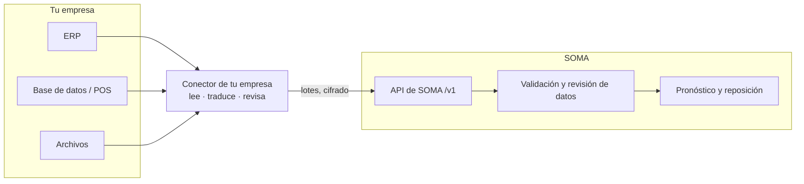

# Integraciones SOMA

**Tus datos llegan a SOMA solos, cada semana, y llegan bien.**

Un conector hecho para tu empresa lee tus sistemas y le entrega a SOMA ventas, inventario y
órdenes. Tu equipo deja de preparar archivos, y el plan de cada semana se calcula con los datos
de esa semana.

!!! info "Estado"
    El envío de ventas funciona de punta a punta en el ambiente de pruebas desde noviembre de
    2026: envío, revisión, aplicación y frescura por ubicación. Inventario y órdenes vienen después.
    Ver [la guía técnica](guia/v1.md#estado) para el detalle por ruta.

## Qué gana tu empresa

| | |
|---|---|
| **Sin archivos que preparar** | Nadie arma ni envía planillas. La carga corre sola, con la frecuencia que se acuerde. |
| **Plan con datos al día** | Pronóstico y reposición se calculan sobre la última semana cerrada, no sobre la planilla del mes pasado. |
| **Errores visibles a tiempo** | Lo que no cuadra se detecta al llegar y se muestra a tu equipo antes de que entre al plan. |

## Cómo funciona

**Tus sistemas** siguen siendo la fuente de verdad. SOMA solo lee, con un usuario de solo
lectura; nada cambia en ellos.

**El conector** es lo único que conoce tu sistema y lo traduce al formato de SOMA: unidades,
formatos numéricos, códigos propios. Comprueba que leyó todo antes de enviar. Lo opera SOMA, o
tu equipo si prefiere enviar directo.

**La API de SOMA** es una sola para todos los clientes. Revisa cada envío, avisa lo que no
cuadra y guarda solo lo que cambió.

## Qué datos viajan

Solo lo que la planificación necesita:

- **Ventas**: por día, ubicación y producto, con las devoluciones aparte.
- **Inventario**: lo disponible en cada ubicación a la fecha de corte.
- **Compras en tránsito**: lo pedido que todavía no llega, y cuándo llega.
- **Producción en curso**: lo que está en planta y cuándo termina.

No viajan datos personales de tus clientes finales, ni órdenes en borrador o anuladas. Los
valores van en dólares y sin IVA.

## Calidad de datos

Un dato malo no detiene la carga, y un dato dudoso no llega al plan sin que alguien lo vea.

- **Lo malo se aparta, lo demás entra.** Una línea con un error queda apartada con su motivo.
  Si son demasiadas, SOMA rechaza el envío completo y conserva los datos anteriores.
- **Nada se borra por accidente.** Si un envío quitaría más datos de lo normal, por ejemplo
  porque el conector no pudo leer todo, queda retenido para revisión.
- **Ubicaciones y productos nuevos, a la vista.** Un producto nuevo entra y espera su ficha. Una
  ubicación nueva detiene la planificación hasta que tu equipo la defina, para que el plan no
  salga corto.
- **El primer envío se compara.** Si tu empresa ya cargaba datos por archivo, el primer envío
  automático espera a que tu equipo compare las cifras y lo apruebe.
- **Solo datos al día.** El conector comprueba que tu sistema ya tiene el período completo antes de
  enviarlo. Una semana a medias no se confunde con una semana sin ventas.
- **Si llega mucho menos de lo normal, se detiene.** Un envío con una fracción de la venta
  esperada queda retenido para revisión.
- **Cada ubicación, con su fecha.** SOMA muestra hasta cuándo tiene datos de cada ubicación y
  avisa la que se atrasa.

## Puesta en marcha

1. **Acceso de solo lectura** (tu equipo): a la fuente de datos (API, base de datos o
   exportación), desde una dirección que tu red pueda autorizar.
2. **Conector en el ambiente de pruebas** (SOMA): se construye y se prueba con una clave de
   pruebas, sin tocar tu plan real.
3. **Comparar las cifras** (juntos): las primeras semanas se comparan contra lo que tu equipo ya
   conoce: unidades, valores y devoluciones.
4. **Carga semanal** (automática): con las cifras validadas, el conector pasa a producción y
   corre solo.

## Continuidad y seguridad

- **Versiones con aviso.** Un cambio que obligue a ajustar el conector sale como versión nueva, y
  la anterior sigue funcionando al menos seis meses.
- **Una clave por empresa**, con permisos solo para los datos que envía. SOMA guarda una huella
  de la clave, nunca la clave.
- **Pruebas y producción separadas.** Cada ambiente tiene su propia clave. Nada de lo que se
  prueba toca el plan real.
- **Nada se pierde en una pausa.** Si SOMA no puede recibir por unos minutos, el conector espera y
  reintenta. Los envíos repetidos no duplican datos.

## Qué necesitamos de tu equipo

- Un acceso de solo lectura a la fuente de datos.
- Una dirección alcanzable con cifrado (HTTPS o VPN).
- Una persona de contacto para validar las cifras de las primeras semanas.
